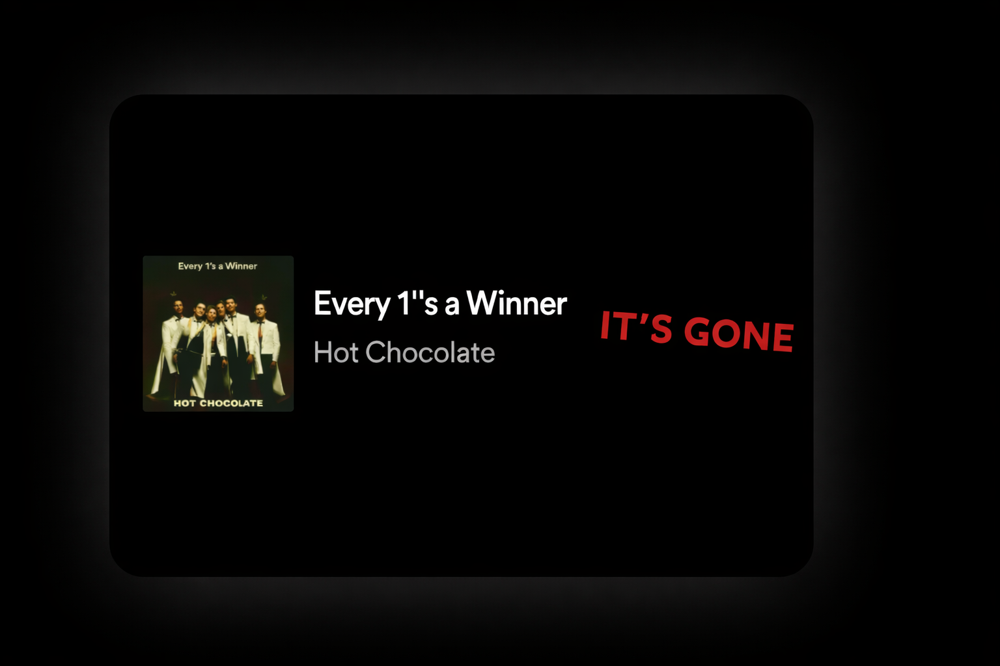

# Lossless Ghost — hide Spotify’s Lossless badge with Spicetify

**Lossless Ghost** is a lightweight Spicetify extension that hides the **Lossless** audio-quality badge in Spotify’s bottom-left **Now Playing** bar. It keeps the track title, artist, and the rest of Spotify’s interface visible.



## Features

- Hides the Lossless badge in Spotify’s Now Playing widget.
- Detects the badge as a button or plain text, including accessible labels.
- Watches Spotify’s UI for track changes and re-renders.
- Limits changes to the Now Playing widget.

## Install from Spicetify Marketplace

Open **Marketplace → Extensions** in Spotify and search for **Lossless Ghost**. This public repository carries the `spicetify-extensions` GitHub topic used by Spicetify Marketplace discovery.

## Manual installation

1. Download [`lossless-ghost.js`](lossless-ghost.js).
2. Copy it into your Spicetify Extensions folder:
   - Windows: `%appdata%\spicetify\Extensions\`
   - macOS/Linux: `~/.config/spicetify/Extensions/`
3. Enable it and apply Spicetify:

   ```bash
   spicetify config extensions lossless-ghost.js
   spicetify apply
   ```

Find the Spicetify configuration folder with `spicetify config-dir`.

## Update

Replace `lossless-ghost.js` with the latest version and run:

```bash
spicetify apply
```

If a Spotify update changed the client build, refresh Spicetify’s backup first:

```bash
spicetify backup apply
```

## Disable or uninstall

Disable the extension while keeping its file:

```bash
spicetify config extensions lossless-ghost.js-
spicetify apply
```

## Tests

Run the DOM smoke tests with Node.js:

```bash
node test-smoke.cjs
```

## License

MIT
